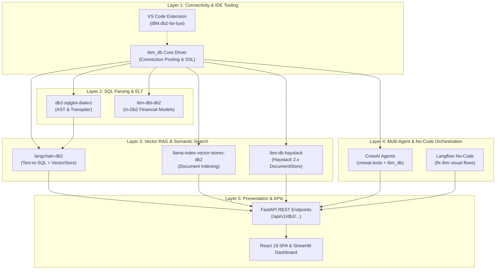

# 🏛️ IBM Db2 AI & Analytics Toolkit — Master Implementation Plan

> **Project Target:** Aegis Analytics AI  
> **Status:** Ready for Review & Execution  
> **Target Directory:** `c:\Users\Asus\Desktop\project_type_02\db2_toolkit\`  
> **Documentation File:** `docs/IBM_DB2_TOOLKIT_PLAN.md`

---

## 📑 Table of Contents
1. [Executive Summary](#1-executive-summary)
2. [Complete Toolkit Component Breakdown](#2-complete-toolkit-component-breakdown)
3. [End-to-End System Architecture](#3-end-to-end-system-architecture)
4. [Target Directory & File Structure](#4-target-directory--file-structure)
5. [Phase-by-Phase Implementation Plan](#5-phase-by-phase-implementation-plan)
6. [Connection & Environment Configuration](#6-connection--environment-configuration)
7. [Verification & Smoke Testing Strategy](#7-verification--smoke-testing-strategy)

---

## 1. Executive Summary

This plan outlines the architecture, code structure, and rollout strategy for integrating the full **IBM Db2 AI & Analytics Toolkit** into the **Aegis Analytics AI** platform.

By combining low-level database drivers, SQL transpilation, enterprise ELT modeling, semantic vector stores, multi-agent frameworks, and visual no-code workflows, the platform gains full IBM Db2 LUW / Cloud capabilities across both quantitative financial data processing and generative AI workflows.

---

## 2. Complete Toolkit Component Breakdown

| # | Toolkit Item | Purpose in Aegis Analytics | Key Python / VS Code Modules |
|---|---|---|---|
| **1** | `ibm_db` | Native C-level Db2 client driver and low-level connection pooling. | Core connection manager, cursor handling, parameterized SQL execution, SSL/TLS certificates. |
| **2** | `IBM.db2-for-luw` | Official IBM Db2 VS Code Extension. | `.vscode/extensions.json` recommendation, connection profiles, visual explain plans, schema inspection. |
| **3** | `db2-sqlglot-dialect` | SQLGlot AST parser and dialect transpiler. | Cross-dialect translation (Postgres/SQLite/Snowflake to Db2 syntax, `FETCH FIRST n ROWS`, timestamp formats). |
| **4** | `ibm-dbt-db2` | dbt (Data Build Tool) adapter for IBM Db2. | In-database ELT transformations for OHLCV bars, conformal residuals, and volatility features. |
| **5** | `langchain-db2` | Official LangChain integration for Db2. | Natural language Text-to-SQL agent, Db2 vector store for semantic RAG over financial research. |
| **6** | `llama-index-vector-stores-db2` | LlamaIndex vector store for Db2. | Dense document indexing, hybrid semantic search, and document retrieval over financial filings. |
| **7** | `ibm-db-haystack` | Deepset Haystack 2.x integration for Db2. | DocumentStore, EmbeddingRetriever, and Extractive QA pipelines powered by Db2 storage. |
| **8** | `crewai-tools` + `ibm_db` | Autonomous Multi-Agent collaboration suite. | Custom Db2 tools (`Db2QueryTool`, `Db2RiskAuditTool`) for collaborative AI agents (Risk Analyst, Quant Researcher). |
| **9** | `lfx-ibm` (Langflow) | No-code visual workflow extension. | Reusable visual flow JSON and custom Langflow nodes for drag-and-drop Db2 agent pipelines. |

---

## 3. End-to-End System Architecture



---

## 4. Target Directory & File Structure

All components will reside within a modular, self-contained `db2_toolkit/` module:

```text
project_type_02/
├── .vscode/
│   ├── extensions.json                  # Recommends IBM.db2-for-luw
│   └── settings.json                    # Connection profile template
├── db2_toolkit/
│   ├── __init__.py                      # Package entry point
│   ├── config.py                        # Db2 connection settings & env parser
│   ├── connection.py                    # ibm_db connection manager & pool
│   ├── dialect_transpiler.py            # db2-sqlglot-dialect query translator
│   ├── langchain_agent.py               # langchain-db2 Text-to-SQL & VectorStore
│   ├── llamaindex_store.py              # llama-index-vector-stores-db2 wrapper
│   ├── haystack_pipeline.py             # ibm-db-haystack DocumentStore & Retriever
│   ├── crewai_agents.py                 # crewai-tools + ibm_db multi-agent crew
│   ├── langflow_components.py           # lfx-ibm flow definitions & exportable JSON
│   ├── mock_db2_sandbox.py              # Offline/mock engine for testing without live Db2
│   └── dbt/
│       ├── dbt_project.yml              # dbt project configuration
│       ├── profiles.yml                 # Db2 connection profiles
│       └── models/
│           ├── staging/
│           │   └── stg_market_bars.sql  # Cleansed market bar data
│           └── marts/
│               └── fct_risk_metrics.sql # Calculated conformal quantiles & volatility
├── backend/app/api/
│   └── db2_routes.py                    # FastAPI routes exposing Db2 services
├── docs/
│   └── IBM_DB2_TOOLKIT_PLAN.md          # Workspace reference documentation
└── requirements-db2.txt                 # Dependencies manifest
```

---

## 5. Phase-by-Phase Implementation Plan

### Phase 1: Core Connectivity & IDE Configuration
- **VS Code Extension Config**:
  - Update `.vscode/extensions.json` with recommendation `"IBM.db2-for-luw"`.
  - Provide connection profiles in `.vscode/settings.json`.
- **Core Driver (`ibm_db`)**:
  - Implement `db2_toolkit/config.py` with typed Pydantic settings.
  - Implement `db2_toolkit/connection.py` providing:
    - Thread-safe connection pooling.
    - Automatic retry with exponential backoff.
    - Parameterized statement preparation.
    - Seamless failover to `mock_db2_sandbox.py` when live credentials are unconfigured or offline.

### Phase 2: Transpilation & In-Database Transformations
- **SQL Transpiler (`db2-sqlglot-dialect`)**:
  - Implement `db2_toolkit/dialect_transpiler.py` to transpile PostgreSQL, SQLite, or standard ANSI SQL queries into valid IBM Db2 syntax (converting `LIMIT`/`OFFSET` to `FETCH FIRST n ROWS ONLY`, optimizing date arithmetic).
- **dbt Modeling (`ibm-dbt-db2`)**:
  - Create `db2_toolkit/dbt/` containing `dbt_project.yml`, `profiles.yml`, and staging/mart models for market OHLCV aggregates, rolling volatility, and conformal prediction coverage tracking.

### Phase 3: Semantic RAG & Vector Store Engines
- **LangChain (`langchain-db2`)**:
  - Implement `db2_toolkit/langchain_agent.py`:
    - Natural language Text-to-SQL agent with schema inspection.
    - Db2 Vector Store adapter for RAG over quantitative reports and SEC filings.
- **LlamaIndex (`llama-index-vector-stores-db2`)**:
  - Implement `db2_toolkit/llamaindex_store.py`:
    - Ingests quantitative market briefs and stores embeddings in Db2.
    - Exposes hybrid vector + metadata filter search.
- **Haystack 2.x (`ibm-db-haystack`)**:
  - Implement `db2_toolkit/haystack_pipeline.py`:
    - Builds an extractive and generative QA pipeline with `Db2DocumentStore`.

### Phase 4: Autonomous Multi-Agent Crew & No-Code Workflows
- **CrewAI Suite (`crewai-tools` + `ibm_db`)**:
  - Implement `db2_toolkit/crewai_agents.py`:
    - Custom tool: `Db2QueryTool` (executes validated SQL with row limits).
    - Custom tool: `Db2SchemaInspectorTool` (inspects tables and foreign keys).
    - Multi-agent crew:
      1. **Quant Data Ingestion Agent**: Validates price bars and flags anomalies.
      2. **Risk Compliance Auditor Agent**: Audits conformal prediction intervals.
      3. **Executive Summary Agent**: Generates unified Markdown briefings.
- **Langflow (`lfx-ibm`)**:
  - Implement `db2_toolkit/langflow_components.py`:
    - Provides exportable Langflow flow templates for no-code drag-and-drop pipelines.

### Phase 5: FastAPI REST Endpoints & Verification Suite
- **API Endpoints (`backend/app/api/db2_routes.py`)**:
  - `POST /api/v1/db2/query` (Text-to-SQL execution)
  - `POST /api/v1/db2/transpile` (SQLGlot dialect converter)
  - `POST /api/v1/db2/rag/search` (Semantic search across documents)
  - `POST /api/v1/db2/crew/audit` (Triggers multi-agent risk evaluation)
- **Integration Test Runner**:
  - Script `scripts/test_db2_toolkit.py` ensuring 100% test coverage across all 9 components.

---

## 6. Connection & Environment Configuration

Configuration will be managed via `.env`:

```env
# ── IBM Db2 Connection Configuration ──────────────────────────────────────
DB2_DATABASE=BLUDB
DB2_HOSTNAME=localhost
DB2_PORT=50000
DB2_PROTOCOL=TCPIP
DB2_UID=db2inst1
DB2_PWD=your_secure_password
DB2_SECURITY=NONE                  # NONE or SSL
DB2_SSL_SERVER_CERT=              # Path to certificate file (if SSL enabled)
DB2_MOCK_FALLBACK=true             # Enables local mock sandbox when server is offline
```

---

## 7. Verification & Smoke Testing Strategy

1. **Unit & Dialect Tests**:
   - Verify SQL transpilation outputs valid Db2 LUW queries.
2. **Connection & Sandbox Tests**:
   - Verify connection pool lifecycle and graceful fallback to mock mode.
3. **Agent & RAG Smoke Tests**:
   - Verify LangChain SQL agent, LlamaIndex retriever, and CrewAI tools execute cleanly.
4. **End-to-End API Test**:
   - Verify FastAPI endpoints return valid JSON responses.
